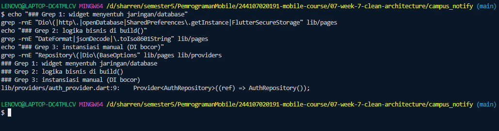
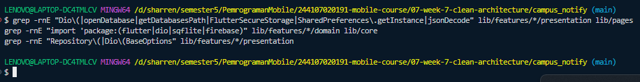
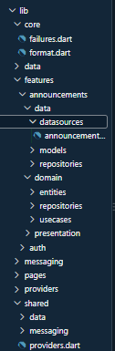
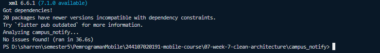
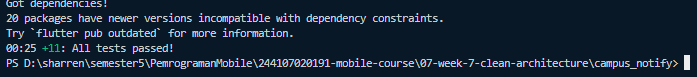
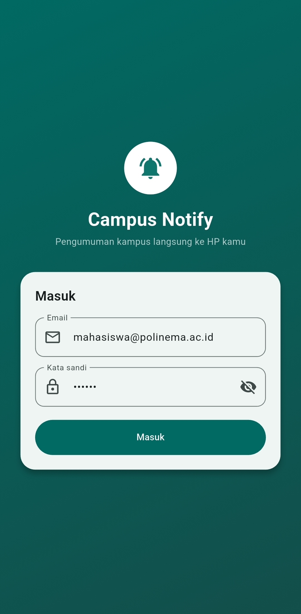
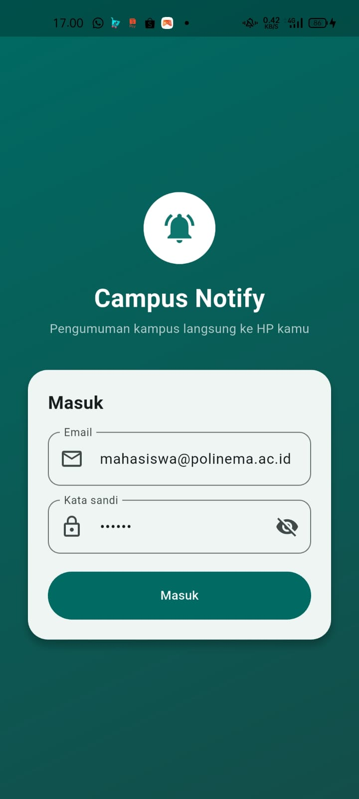
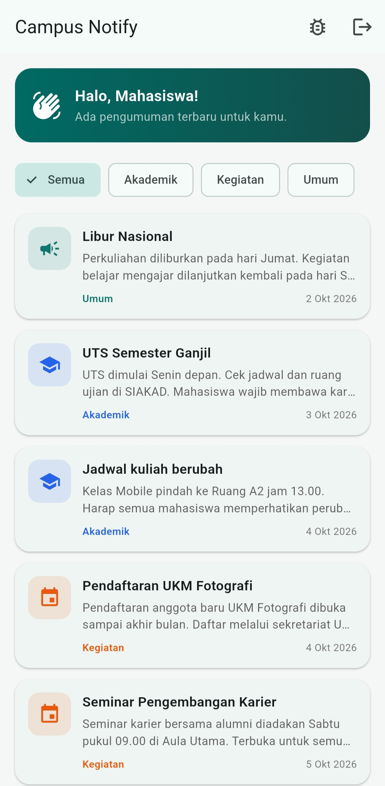
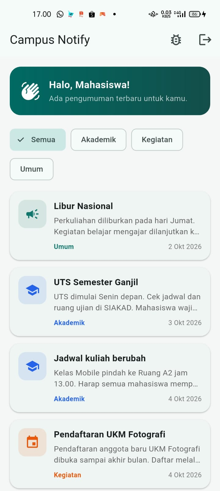
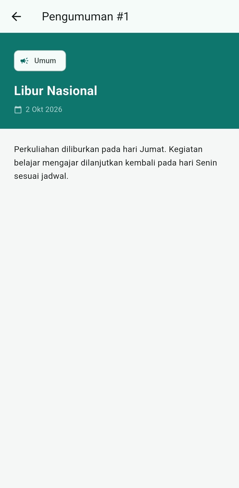

# Pemrograman Mobile

## Praktikum Week 7 - Clean Architecture

## Identitas

| Field | Detail |
| :--- | :--- |
| **Nama** | *Sharren Elvaretta Pratamadya Fianto* |
| **NIM** | *244107020191* |
| **Kelas** | *TI 3G* |
| **Praktikum 1: Audit Layer Project Lama** | campus_notify |
| **Praktikum 2: Domain dan Data per Fitur** | campus_notify |
| **Praktikum 3: Presentation, DI, dan Verifikasi** | campus_notify |
| **Tugas Praktikum / Industry Challenge** | Pertemuan 7 |

---

# Ringkasan Proyek

* **Project Name**: `campus_notify`
* **Tujuan**: Menerapkan prinsip **SOLID** dan arsitektur **Clean Architecture (Feature-First)** pada aplikasi mobile `campus_notify` (lanjutan dari praktikum Week 6). Tujuannya adalah memutus ketergantungan terlarang antar-layer, memastikan logika bisnis independen dari framework UI/Dio/Firebase, serta memudahkan pengujian unit (unit testing) tanpa emulator atau database nyata.
* **Fitur Utama**:
  1. **Authentication**: Login dengan validasi kredensial bisnis, penyimpanan sesi token aman, dan automatic refresh token.
  2. **Announcements**: Daftar pengumuman terfilter per kategori, pengurutan otomatis berdasarkan tanggal terbaru (*business rules*), serta tampilan detail pengumuman.
  3. **FCM & Push Service**: Penanganan lifecycle notifikasi, topik pengumuman, dan deep linking route murni.
* **Tech Stack**: Flutter (Dart 3.x), Flutter Riverpod (State Management & DI), GoRouter, Dio (HTTP Client), Flutter Secure Storage, Firebase Messaging, Flutter Local Notifications.

---

# Konsep SOLID & Clean Architecture

### 1. Prinsip SOLID dalam Konteks Flutter
1. **Single Responsibility Principle (SRP)**: Setiap kelas hanya memiliki satu alasan untuk berubah. Contoh: Widget halaman tidak lagi melakukan fetch API atau parsing tanggal, melainkan murni merender state UI.
2. **Open/Closed Principle (OCP)**: Terbuka untuk ekstensi, tertutup untuk modifikasi. Menambah implementasi repository baru (misal ganti Mock ke Dio API sungguhan) tidak memaksa pengubahan kode use case atau presentation.
3. **Liskov Substitution Principle (LSP)**: Kelas turunan atau pengganti harus dapat menggantikan kontrak aslinya tanpa merusak sistem. Contoh: `FakeAnnouncementRepository` pada unit test dapat menggantikan `AnnouncementRepositoryImpl` tanpa melempar unexpected exception.
4. **Interface Segregation Principle (ISP)**: Klien tidak dipaksa bergantung pada interface yang tidak digunakan. Repository dipecah per fitur (`AuthRepository`, `AnnouncementRepository`), bukan satu interface raksasa `AppRepository`.
5. **Dependency Inversion Principle (DIP)**: Modul tingkat tinggi (domain / presentation) bergantung pada abstraksi (interface), bukan implementasi konkret. Notifier dan Use Case bergantung pada `AnnouncementRepository`, bukan `AnnouncementRepositoryImpl`.

### 2. Aturan Dependensi (Dependency Rule)

```text
presentation (widgets, notifiers, router)
      │
      ▼  (bergantung ke)
domain (entities, repository interfaces, use cases, failures)
      ▲
      │  (diimplementasikan oleh)
data (models, repository impl, datasources, Dio, secure storage)
```

> **Aturan Emas**: Arah panah dependensi selalu mengarah ke dalam (**Domain**). Layer `domain` murni Dart dan tidak tahu apa pun mengenai Flutter UI, Dio HTTP, SQLite, maupun Firebase SDK.

---

# Praktikum 1: Audit Layer Project Lama

**Project:** `campus_notify`

## 1. Pemetaan File ke Layer (Sebelum Refactor)

| File Lama | Layer Lama | Masalah Arsitektur |
| :--- | :--- | :--- |
| `lib/pages/home_page.dart` | presentation | Parsing dan formatting tanggal di widget; data pengumuman statis tercampur di UI |
| `lib/pages/announcement_page.dart` | presentation | Mengambil data langsung tanpa abstraksi repository |
| `lib/pages/login_page.dart` | presentation | Validasi format email & password dilakukan di UI/controller |
| `lib/providers/auth_provider.dart` | presentation (state) | **DI Bocor**: Menginstansiasi `AuthRepository()` konkret langsung di provider |
| `lib/data/auth_repository.dart` | data (+ kontrak) | Interface dan implementasi menyatu dalam satu kelas konkret; melempar Exception mentah |
| `lib/data/api_client.dart` | data | Interceptor refresh token bergantung pada kelas konkret `AuthRepository` |
| `lib/data/token_store.dart` | data | Penyimpanan token aman (sudah baik, perlu dipindahkan ke layer shared) |
| `lib/data/api_errors.dart` | data | Error handling masih mengembalikan String/Exception, belum objek `Failure` |
| `lib/messaging/push_service.dart` | infrastruktur | Logika parsing route (`routeFromMessage`) tercampur dengan Firebase SDK |

---

## 2. Tiga Pelanggaran Klasik (Audit Grep SEBELUM Refactor)

Pencarian grep dijalankan pada proyek sebelum refactor:

```bash
# 1. Widget yang menyentuh jaringan / database langsung
grep -rnE "Dio\(|http\.|openDatabase|SharedPreferences\.getInstance|FlutterSecureStorage" lib/pages

# 2. Logika bisnis di dalam build()
grep -rnE "DateFormat|jsonDecode|\.toIso8601String" lib/pages

# 3. Instansiasi manual (DI bocor)
grep -rnE "Repository\(|Dio\(BaseOptions" lib/pages lib/providers
```

### Hasil Audit Grep Before:
* **Grep 1 & 2**: Nol temuan (widget UI sudah terpisah dari pemanggilan Dio/Storage langsung).
* **Grep 3 (Temuan Kritis)**: Ditemukan 1 pelanggaran DI bocor di `lib/providers/auth_provider.dart:9`:
  ```dart
  Provider<AuthRepository>((ref) => AuthRepository());
  ```
* **Kesimpulan Audit**: Pelanggaran utama pada proyek lama terletak pada **struktur**: kontrak interface belum dipisah dari implementasi, provider menginstansiasi kelas konkret secara langsung, exception mentah bocor ke UI, dan format tanggal belum diekstrak.

| Hasil Audit Grep Sebelum Refactor | Struktur Explorer Sebelum Refactor |
| :---: | :---: |
|  |  |

---

## 3. Struktur Target (Feature-First Clean Architecture)

```text
lib/
├── main.dart
├── routes.dart
├── theme.dart
├── core/                                     # Murni Dart (tanpa Flutter/Dio/Firebase)
│   ├── failures.dart                         # Failure class hierarchy
│   └── format.dart                           # formatDate & routeFromMessage
├── shared/                                   # Infrastruktur lintas fitur & wiring global
│   ├── providers.dart                        # tokenStoreProvider, dioProvider
│   ├── data/
│   │   ├── api_client.dart
│   │   ├── api_errors.dart
│   │   └── token_store.dart
│   └── messaging/
│       ├── debug_page.dart
│       └── push_service.dart
└── features/
    ├── announcements/                        # Fitur 1 (Announcements)
    │   ├── domain/
    │   │   ├── entities/announcement.dart
    │   │   ├── repositories/announcement_repository.dart
    │   │   └── usecases/get_announcements.dart
    │   ├── data/
    │   │   ├── datasources/announcement_mock_source.dart
    │   │   ├── models/announcement_model.dart
    │   │   └── repositories/announcement_repository_impl.dart
    │   └── presentation/
    │       ├── providers/announcement_providers.dart
    │       └── pages/
    │           ├── home_page.dart
    │           └── announcement_page.dart
    └── auth/                                 # Fitur 2 (Authentication)
        ├── domain/
        │   ├── entities/auth_session.dart
        │   ├── repositories/auth_repository.dart
        │   └── usecases/login.dart
        ├── data/
        │   └── repositories/auth_repository_impl.dart
        └── presentation/
            ├── providers/auth_providers.dart
            └── pages/
                └── login_page.dart
```

---

# Praktikum 2: Domain dan Data per Fitur

## 1. Domain Layer (Murni Logika Bisnis)

### A. Failure Hierarchy (`lib/core/failures.dart`)
Semua error dikapsulasi menjadi subclass dari `Failure` sehingga UI hanya menerima pesan ramah pengguna tanpa kebocoran exception teknis:
```dart
sealed class Failure {
  const Failure(this.message);
  final String message;
}

class LocalFailure extends Failure {
  const LocalFailure(super.message);
}

class NetworkFailure extends Failure {
  const NetworkFailure(super.message);
}

class AuthFailure extends Failure {
  const AuthFailure(super.message);
}
```

### B. Entity Murni (`lib/features/announcements/domain/entities/announcement.dart`)
Objek bisnis murni tanpa impor Flutter dan tanpa method serialization (`toMap`/`fromJson`):
```dart
class Announcement {
  const Announcement({
    required this.id,
    required this.title,
    this.body = '',
    this.category = 'Umum',
    required this.publishedAt,
  });

  final String id;
  final String title;
  final String body;
  final String category;
  final DateTime publishedAt;
}
```

### C. Repository Interface & Dart Records (`lib/features/announcements/domain/repositories/announcement_repository.dart`)
Menggunakan Dart Records eksplisit `({T? item, Failure? failure})`:
```dart
abstract class AnnouncementRepository {
  Future<({List<Announcement> items, Failure? failure})> fetchAnnouncements();
  Future<({Announcement? item, Failure? failure})> fetchById(String id);
}
```

### D. Use Case Beraturan Bisnis (`lib/features/announcements/domain/usecases/get_announcements.dart`)
Use case ini memegang aturan bisnis: memfilter kategori dan menyortir pengumuman dari yang terbaru:
```dart
class GetAnnouncements {
  const GetAnnouncements(this._repository);
  final AnnouncementRepository _repository;

  Future<({List<Announcement> items, Failure? failure})> call({String? category}) async {
    final result = await _repository.fetchAnnouncements();
    if (result.failure != null) return result;

    var list = [...result.items];
    if (category != null && category != 'Semua') {
      list = list.where((a) => a.category == category).toList();
    }
    list.sort((a, b) => b.publishedAt.compareTo(a.publishedAt));
    return (items: list, failure: null);
  }
}
```

---

## 2. Data Layer (Mapping & Implementasi)

### A. Data Model (`lib/features/announcements/data/models/announcement_model.dart`)
Model bertindak sebagai adapter antara data luar (JSON/Map) ke Entity:
```dart
class AnnouncementModel extends Announcement {
  const AnnouncementModel({
    required super.id,
    required super.title,
    super.body = '',
    super.category = 'Umum',
    required super.publishedAt,
  });

  factory AnnouncementModel.fromJson(Map<String, dynamic> json) {
    return AnnouncementModel(
      id: '${json['id']}',
      title: json['title'] as String? ?? '',
      body: json['body'] as String? ?? '',
      category: json['category'] as String? ?? 'Umum',
      publishedAt: DateTime.tryParse(json['published_at'] as String? ?? '') ??
          DateTime.fromMillisecondsSinceEpoch(0),
    );
  }

  Announcement toEntity() => Announcement(
        id: id,
        title: title,
        body: body,
        category: category,
        publishedAt: publishedAt,
      );
}
```

### B. Repository Implementation (`lib/features/announcements/data/repositories/announcement_repository_impl.dart`)
Mengambil data dari datasource dan mengembalikan Entity murni:
```dart
class AnnouncementRepositoryImpl implements AnnouncementRepository {
  final List<Announcement> _mockList = kAnnouncements;

  @override
  Future<({List<Announcement> items, Failure? failure})> fetchAnnouncements() async {
    try {
      await Future.delayed(const Duration(milliseconds: 200));
      return (items: List<Announcement>.unmodifiable(_mockList), failure: null);
    } catch (e) {
      return (items: const <Announcement>[], failure: NetworkFailure('Gagal memuat: $e'));
    }
  }

  @override
  Future<({Announcement? item, Failure? failure})> fetchById(String id) async {
    try {
      await Future.delayed(const Duration(milliseconds: 100));
      final item = _mockList.where((a) => a.id == id).firstOrNull;
      return (item: item, failure: null);
    } catch (e) {
      return (item: null, failure: NetworkFailure('Gagal memuat: $e'));
    }
  }
}
```

---

# Praktikum 3: Presentation, DI, dan Verifikasi

## 1. Dependency Injection dengan Riverpod

Seluruh wiring ketergantungan didefinisikan secara terpusat tanpa `new Repository()` di dalam widget.

**`lib/features/announcements/presentation/providers/announcement_providers.dart`**
```dart
final announcementRepositoryProvider = Provider<AnnouncementRepository>(
  (ref) => AnnouncementRepositoryImpl(),
);

final getAnnouncementsProvider = Provider<GetAnnouncements>(
  (ref) => GetAnnouncements(ref.watch(announcementRepositoryProvider)),
);

final announcementsProvider = FutureProvider<List<Announcement>>((ref) async {
  final r = await ref.watch(getAnnouncementsProvider).call();
  if (r.failure != null) throw Exception(r.failure!.message);
  return r.items;
});

// Category Filter Notifier (Riverpod 3.x compatible)
class CategoryNotifier extends Notifier<String> {
  @override
  String build() => 'Semua';
  void select(String value) => state = value;
}

final selectedCategoryProvider =
    NotifierProvider<CategoryNotifier, String>(CategoryNotifier.new);

final filteredAnnouncementsProvider =
    FutureProvider<List<Announcement>>((ref) async {
  final category = ref.watch(selectedCategoryProvider);
  final r = await ref.watch(getAnnouncementsProvider).call(category: category);
  if (r.failure != null) throw Exception(r.failure!.message);
  return r.items;
});

// Detail pengumuman langsung memanggil repository (tanpa use case over-engineering)
final announcementDetailProvider =
    FutureProvider.family<Announcement?, String>((ref, id) async {
  final r = await ref.watch(announcementRepositoryProvider).fetchById(id);
  if (r.failure != null) throw Exception(r.failure!.message);
  return r.item;
});
```

---

## 2. Halaman Murni Presentation

`HomePage` dan `AnnouncementPage` hanya membaca state dari Riverpod dan tidak mengandung query SQL, Dio HTTP, atau formatting tanggal mentah:

```dart
// Pola konsumsi di HomePage
final announcementsAsync = ref.watch(filteredAnnouncementsProvider);

announcementsAsync.when(
  loading: () => const Center(child: CircularProgressIndicator()),
  error: (err, _) => Center(child: Text('Gagal: $err')),
  data: (items) => ListView.builder(
    itemCount: items.length,
    itemBuilder: (_, i) => AnnouncementCard(item: items[i]),
  ),
);
```

---

## 3. Verifikasi Dependency Rule (Grep Sterilitas AFTER)

Tiga pemeriksaan sterilitas dijalankan pada seluruh codebase setelah refactor:

```bash
# 1. Presentation steril dari data mentah & database
grep -rnE "Dio\(|openDatabase|getDatabasesPath|FlutterSecureStorage|SharedPreferences\.getInstance|jsonDecode" lib/features/*/presentation lib/pages

# 2. Domain & core steril dari framework eksternal
grep -rnE "import 'package:(flutter|dio|sqflite|firebase)" lib/features/*/domain lib/core

# 3. Presentation steril dari instansiasi manual (DI bocor)
grep -rnE "Repository\(|Dio\(BaseOptions" lib/features/*/presentation
```

**Hasil: 0 temuan (NOL HASIL) pada ketiga pemeriksaan.** Seluruh layer terbukti steril dan mematuhi aturan Clean Architecture!

| Hasil Tiga Grep Sterilitas (After) | Struktur Explorer Sesudah Refactor |
| :---: | :---: |
|  |  |

---

# AI Challenge & Refactoring Challenge

## 1. AI Prompt Challenge
Dokumentasi lengkap AI Challenge disimpan di folder `docs/`:
* [`docs/ai-prompt.md`](docs/ai-prompt.md): Prompt analisis arsitektur awal.
* [`docs/ai-output.md`](docs/ai-output.md): Rekomendasi awal model AI.
* [`docs/ai-decision-table.md`](docs/ai-decision-table.md): Tabel keputusan teknis dan trade-off.
* [`docs/ai-verification.md`](docs/ai-verification.md): Checklist verifikasi 5 poin.

## 2. Tabel Usulan AI vs Keputusan Final

| Usulan Awal AI | Keputusan Final | Alasan Teknis & Trade-off |
| :--- | :--- | :--- |
| Membuat Use Case untuk setiap operasi (termasuk `fetchById` dan `logout`) | Hanya membuat Use Case untuk `GetAnnouncements` dan `Login`. `fetchById` langsung dipanggil dari Provider. | Operasi `fetchById` hanya 1 baris pembacaan data tanpa logika bisnis tambahan. Membuat use case terpisah adalah **over-engineering** yang menambah kompleksitas tanpa keuntungan nyata. |
| Meletakkan `api_client.dart` di `lib/core/` | Memindahkan `api_client.dart` ke `lib/shared/data/`. | Folder `lib/core/` harus murni Dart. Mengimpor `dio` di dalam `core/` melanggar aturan sterilitas dependensi. |
| Menambahkan pustaka DI eksternal (`get_it`) | Menggunakan bawaan **Riverpod**. | Riverpod sudah menyediakan container DI deklaratif yang aman saat kompilasi tanpa perlu dependensi tambahan. |
| Menggunakan `StateProvider` untuk filter UI | Menggunakan `NotifierProvider` dengan `CategoryNotifier`. | Pada versi Riverpod 3.x, `StateProvider` telah deprecated/dihapus. |

## 3. AI Verification Checklist
- [x] Interface repository berada di `domain` dan implementasi di `data`.
- [x] Domain dan core 100% bebas import Flutter / Dio / SQLite / Firebase.
- [x] Tidak ada use case berlebihan untuk operasi CRUD satu-baris.
- [x] Entity bebas mapping (`fromJson` hanya ada di Model).
- [x] Wiring DI terpusat di provider, widget tidak pernah melakukan `new Repository()`.

---

# Unit Testing & Verifikasi Statis

Pengujian domain dilakukan secara murni tanpa framework UI, emulator, database, maupun jaringan internet:
* `test/get_announcements_test.dart`: Menguji logika pengurutan tanggal terbaru, filtering kategori, dan propagasi Failure menggunakan `FakeAnnouncementRepository`.
* `test/auth_push_test.dart`: Menguji pemetaan route murni `routeFromMessage`, validasi kredensial login, interceptor token refresh 401, dan pembersihan sesi saat refresh gagal.

### Bukti Pengujian & Analisis:

| Flutter Analyze (0 Error) | Flutter Test (11 Passed) |
| :---: | :---: |
|  |  |

---

# Perbandingan Hasil UI (Before vs After)

> Sesuai ketentuan Jobsheet, refactor Clean Architecture mempertahankan fungsionalitas dan antarmuka pengguna (UI) secara **100% identik**, sementara struktur internal kode berubah menjadi terpisah dan modular.

| Halaman | Sebelum Refactor (Week 6) | Sesudah Refactor (Week 7) |
| :--- | :---: | :---: |
| **Login Page** |  |  |
| **Home Page (Announcements)** |  |  |
| **Detail Pengumuman** |  |  |

---

# Error Umum dan Solusinya

| Gejala Error | Penyebab Umum | Solusi yang Diterapkan |
| :--- | :--- | :--- |
| `return_of_invalid_type` pada fetchAnnouncements | `List.unmodifiable` mengembalikan `List<dynamic>` | Menggunakan tipe eksplisit `List<Announcement>.unmodifiable(_mockList)` |
| `undefined_function StateProvider` | Riverpod 3.x menghapus `StateProvider` | Mengganti dengan `NotifierProvider` dan class `CategoryNotifier` murni |
| `undefined_class Failure` di file unit test | Path import test masih merujuk ke arsitektur lama | Mengimpor `package:campus_notify/core/failures.dart` dan entities |
| `Out of memory` saat kompilasi Gradle | Gradle Daemon dan Dart Compiler kehabisan RAM laptop | Jalankan `flutter clean` dan set alokasi memori JVM yang optimal |

---

# Checklist Verifikasi Mandiri

* [x] Struktur folder feature-first (`features/announcements`, `features/auth`, `core`, `shared`).
* [x] Interface repository berada di domain, implementasi berada di data.
* [x] Entity murni bisnis tanpa metode serialisasi JSON/Map.
* [x] Mapping data (`fromJson`/`toEntity`) hanya ada di layer data model.
* [x] Widget tidak menginstansiasi repository/Dio secara manual (DI via Riverpod).
* [x] Tiga grep sterilitas (presentation & domain) menghasilkan 0 temuan.
* [x] Tampilan aplikasi berjalan identik sebelum dan sesudah refactor.
* [x] `flutter analyze` bersih tanpa issue (`No issues found!`).
* [x] Seluruh unit test lulus (`All tests passed!`).
* [x] Folder `docs/` berisi dokumentasi AI Challenge lengkap.

---

# Kesimpulan

1. **Clean Architecture** memisahkan kode berdasarkan stabilitas dan tanggung jawab bisnis, bukan sekadar memindahkan file ke folder berbeda. Logika bisnis di layer domain terlindungi dari perubahan framework eksternal.
2. **Feature-First Architecture** memudahkan skalabilitas tim; fitur `announcements` dan `auth` berdiri secara independen dengan dependensi terarah ke dalam.
3. **Pengujian Domain Terisolasi**: Logika bisnis (pengurutan tanggal, validasi auth, filtering kategori) dapat diuji 100% menggunakan repository palsu (*fake/mock*) dengan eksekusi sangat cepat tanpa membutuhkan emulator.
4. **Pragmatisme Arsitektur**: Menghindari *over-engineering* dengan tidak membuat use case pada operasi CRUD satu baris yang tidak memiliki aturan bisnis.

---

# Refleksi

### 1. Mengapa interface repository harus tinggal di domain, bukan di data? Apa yang rusak bila dibalik?
Jika interface ditaruh di layer data, maka layer domain harus mengimpor layer data untuk memanggil kontrak tersebut. Hal ini melanggar **Dependency Inversion Principle** dan **Aturan Dependensi Clean Architecture** (arah panah dependensi menjadi terbalik: *domain bergantung pada data*). Akibatnya, logika bisnis menjadi terikat pada detail implementasi luar, dan domain tidak lagi dapat diuji secara independen tanpa mengikutsertakan library data.

### 2. Kapan use case benar-benar dibutuhkan, dan kapan repository langsung ke notifier sudah cukup?
Use case benar-benar dibutuhkan ketika sebuah operasi melibatkan **aturan bisnis** (misalnya validasi input kompleks, kombinasi data dari lebih dari satu repository, sorting/filtering kustom, atau transformasi data). Sebaliknya, untuk operasi CRUD sederhana satu baris (seperti mengambil detail entitas berdasarkan ID), memanggil repository langsung dari notifier sudah cukup agar tidak menimbulkan boilerplate berlebihan.

### 3. Apa biaya over-engineering (use case per CRUD satu-baris) bagi tim kecil? Kapan biayanya sepadan?
Biaya over-engineering adalah bertambahnya jumlah file, kode boilerplate, dan waktu navigasi kode yang memperlambat laju pengembangan fitur baru bagi tim kecil. Biaya tersebut baru sepadan ketika aplikasi berskala besar dengan banyak anggota tim yang bekerja paralel, atau saat aturan bisnis pada operasi tersebut sering berubah-ubah dan memerlukan unit test tersendiri.

### 4. Bagian mana dari usulan AI yang Anda tolak atau sederhanakan, dan mengapa?
Saya menolak usulan AI untuk membuat use case pada setiap operasi (seperti `fetchById` dan `logout`) karena keduanya hanya meneruskan pemanggilan repository satu baris tanpa aturan bisnis. Selain itu, saya menolak usulan menaruh `api_client` di `core/`, karena `core/` harus murni Dart agar lulus uji sterilitas grep terhadap package `dio`.
