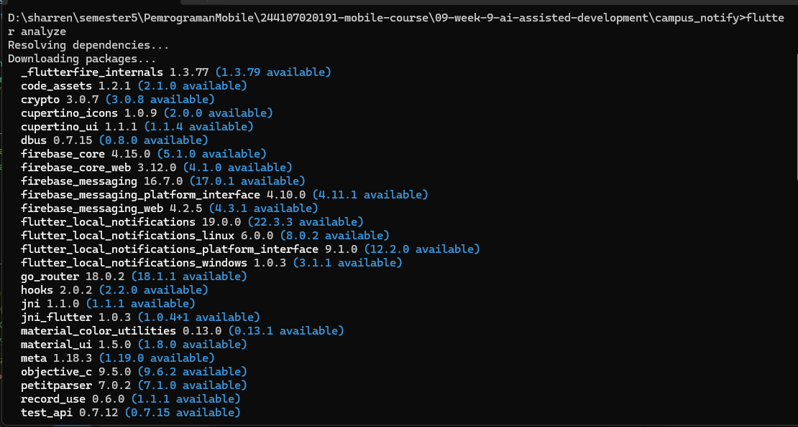
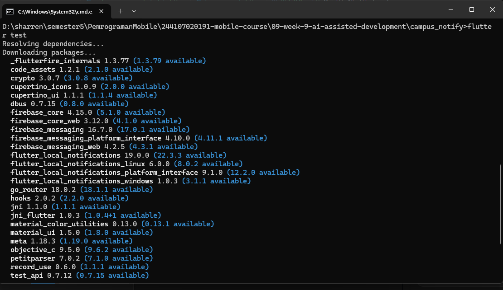

# Pemrograman Mobile

## Praktikum Week 9 - AI-Assisted Development & Vibe Coding

## Identitas

| Field | Detail |
| :--- | :--- |
| **Nama** | *Sharren Elvaretta Pratamadya Fianto* |
| **NIM** | *244107020191* |
| **Kelas** | *TI 3G* |
| **Praktikum 1: Prompt dan Context Engineering** | `campus_notify` |
| **Praktikum 2: Generate dan Verifikasi Search** | `campus_notify` |
| **Praktikum 3: Debug dan Refactor** | `campus_notify` |
| **Tugas Praktikum / Industry Challenge** | Pertemuan 9 |

---

# Ringkasan Proyek

* **Project Name**: `campus_notify`
* **Tujuan**: Menerapkan AI-assisted development dalam pengembangan aplikasi Flutter dengan menggunakan AI sebagai alat bantu untuk menghasilkan kode, melakukan debugging, dan memberikan rekomendasi refactoring. Seluruh hasil AI diverifikasi agar tetap sesuai dengan prinsip Clean Architecture dan mudah diuji.
* **Fitur Utama**:
  1. **Search Notes**: Pencarian notes berdasarkan judul dengan mengabaikan perbedaan huruf besar dan kecil.
  2. **Empty State**: Menampilkan informasi ketika pencarian tidak menemukan hasil.
  3. **Unit Testing**: Menguji pencarian dengan hasil yang cocok maupun tidak cocok.
  4. **Refactoring**: Memisahkan logika pencarian dari widget ke fungsi atau use case domain.
  5. **AI Verification**: Mengevaluasi saran AI berdasarkan kode, hasil pengujian, dan kesesuaian arsitektur.
* **Tech Stack**: Flutter, Dart, Riverpod, Clean Architecture, Flutter Test, Git, dan AI Coding Assistant. SQLite dan Dio digunakan sesuai kebutuhan project yang sudah ada.

---

# Konsep AI-Assisted Development

### 1. Workflow AI-Assisted Development

Pengembangan aplikasi dengan bantuan AI dilakukan melalui enam tahapan:

1. **Prompt**: Memberikan instruksi, konteks project, dan batasan yang jelas kepada AI.
2. **Generate**: Meminta AI menghasilkan kode berdasarkan kebutuhan fitur.
3. **Verify**: Memeriksa kode, import, method, dan API yang digunakan.
4. **Test**: Menjalankan `flutter analyze` dan pengujian otomatis.
5. **Refactor**: Memperbaiki kode agar lebih sederhana dan sesuai arsitektur.
6. **Explain**: Memahami dan menjelaskan kode serta keputusan teknis secara mandiri.

### 2. Mengenali Halusinasi AI

Halusinasi AI adalah kondisi ketika AI memberikan informasi atau kode yang terlihat benar, tetapi sebenarnya keliru.

Contohnya:

1. **Method tidak tersedia**: AI menggunakan method yang tidak dimiliki class atau package.
2. **API tidak sesuai versi**: AI menggunakan API yang sudah berubah atau tidak tersedia pada dependency project.
3. **Logika salah**: Pencarian tidak mengabaikan huruf besar dan kecil atau menghasilkan data yang tidak sesuai.
4. **Pelanggaran arsitektur**: Widget mengakses database secara langsung atau domain mengimpor package Flutter.

Setiap temuan harus dibuktikan melalui pemeriksaan kode, dokumentasi API, atau test.

---

# Praktikum 1: Prompt dan Context Engineering

## 1. Formula Prompt Lima Slot

Prompt disusun berdasarkan lima bagian utama:

| Bagian | Isi |
| :--- | :--- |
| Peran | Senior Flutter Developer |
| Konteks | Flutter, Riverpod, dan Clean Architecture |
| Tugas | Menambahkan pencarian judul notes dan empty state |
| Batasan | Tidak mengubah arsitektur dan fitur yang sudah ada |
| Output | Kode, test, dan langkah verifikasi |

## 2. Prompt yang Digunakan

```text
Peran: Senior Flutter Developer.

Konteks: Project campus_notify menggunakan Flutter,
Riverpod, dan Clean Architecture dengan pemisahan
presentation, domain, dan data.

Tugas: Tambahkan fitur pencarian berdasarkan judul
notes dan tampilkan empty state jika tidak ada hasil.

Batasan:
- Pertahankan struktur project yang sudah ada.
- Jangan mengakses database langsung dari widget.
- Pisahkan logika pencarian dari UI.
- Sesuaikan implementasi dengan dependency project.
- Jangan mengubah file yang tidak diperlukan.

Output:
- Daftar file yang diubah.
- Kode lengkap.
- Minimal dua unit test dan satu widget test.
- Langkah menjalankan analyze dan test.
```

## 3. Konteks Project

Konteks yang diberikan kepada AI meliputi struktur folder, kontrak repository, state management, dan versi dependency yang relevan.

Informasi sensitif seperti API key, password, JWT, dan token FCM tidak disertakan dalam prompt.

---

# Praktikum 2: Generate dan Verifikasi Search

## 1. Implementasi Fitur Search

Fitur pencarian digunakan untuk memfilter notes berdasarkan judul.

Kriteria implementasi:

- Pencarian dapat menemukan judul yang cocok.
- Pencarian tidak membedakan huruf besar dan kecil.
- Hasil kosong ditampilkan melalui empty state.
- Logika pencarian dipisahkan dari widget.
- Implementasi mengikuti struktur project yang sudah ada.

## 2. Pengujian Search

Contoh test yang digunakan untuk memverifikasi aturan pencarian:

```dart
test('pencarian mengabaikan huruf besar dan kecil', () {
  final result = filterNotes(list, 'belanja');

  expect(result, hasLength(2));
});

test('pencarian tanpa hasil mengembalikan list kosong', () {
  final result = filterNotes(list, 'zzz-tak-ada');

  expect(result, isEmpty);
});
```

*Catatan: sesuaikan nama fungsi dan data test dengan implementasi akhir.*

## 3. Verifikasi Kode AI

Verifikasi dilakukan dengan memeriksa import, method, logika pencarian, dan hasil test.

Perintah yang digunakan:

```bash
flutter analyze
flutter test
```

Pengujian manual dilakukan dengan tiga kondisi:

1. Query kosong.
2. Query yang cocok dengan judul notes.
3. Query yang tidak cocok dan menghasilkan empty state.

## 4. Bukti Verifikasi

| Pemeriksaan | Bukti |
| :--- | :--- |
| Kode hasil AI | `docs/ai-log.md` |
| Unit test search | `test/search_filter_test.dart` |
| Widget test empty state | File test yang sesuai dengan struktur project |
| Hasil analisis kode | Screenshot terminal `flutter analyze` |
| Hasil pengujian | Screenshot terminal `flutter test` |

---

# Praktikum 3: Debug dan Refactor

## 1. Debugging

Proses debugging dilakukan dengan langkah berikut:

1. Menjalankan kode untuk menemukan masalah.
2. Menentukan bagian kode yang menyebabkan masalah.
3. Membuat test yang membuktikan kesalahan.
4. Memperbaiki kode dan menjalankan ulang test.
5. Mencatat penyebab dan solusi di `docs/ai-log.md`.

## 2. Refactoring ke Clean Architecture

Struktur alur pencarian:

```text
presentation (widget)
       |
       v
Riverpod Notifier
       |
       v
domain (search use case)
       |
       v
repository (data notes)
```

Widget bertanggung jawab menampilkan UI, Notifier mengelola state, dan use case menangani aturan pencarian. Repository digunakan untuk memperoleh data sesuai implementasi project.

## 3. Verifikasi Akhir

Perintah yang digunakan:

```bash
dart format .
flutter analyze
flutter test
```

Kode dinyatakan siap setelah format, analisis statis, dan test selesai dijalankan serta seluruh masalah yang ditemukan telah ditangani.

---

# AI Challenge & Refactoring Challenge

## 1. AI Prompt Challenge

AI diminta melakukan review terhadap kode search yang telah dibuat.

```text
Review kode search Flutter ini sebagai senior developer.

Konteks: Feature-first Clean Architecture,
presentation -> domain <- data, dan Riverpod.

Fokus pada kebenaran logika, arsitektur, dan testing.
Abaikan masalah style.

Berikan tiga temuan, tingkat prioritas, alasan teknis,
dan cara membuktikan setiap temuan melalui kode atau test.
Jangan menganggap method atau API tersedia sebelum
memeriksa implementasi dan dependency project.
```

Dokumentasi AI disimpan di folder `docs/`:

- `docs/ai-log.md`: Prompt, output awal AI, proses verifikasi, dan refleksi.
- `docs/ai-decision-table.md`: Tabel usulan AI dan keputusan akhir.

## 2. Tabel Usulan AI vs Keputusan Final

| Usulan AI | Keputusan | Alasan Teknis |
| :--- | :--- | :--- |
| Filter judul langsung di widget | Tolak | Logika pencarian lebih mudah diuji jika dipisahkan dari UI. |
| Memindahkan pencarian ke use case domain | Terima | Aturan pencarian dapat diuji tanpa menjalankan widget. |
| Menggunakan method yang belum tersedia | Tolak sampai terverifikasi | API harus sesuai dengan kode dan versi dependency. |
| Menambahkan package baru untuk pencarian sederhana | Tolak jika tidak diperlukan | Fungsi Dart bawaan sudah cukup untuk pencarian judul sederhana. |

*Keputusan akhir harus disesuaikan dengan saran AI yang benar-benar muncul dan bukti yang ditemukan selama praktikum.*

## 3. AI Verification Checklist

- [x] Prompt lima slot dan konteks dicatat.
- [x] Output awal AI disimpan.
- [x] Minimal satu temuan AI terbukti benar dan diperbaiki.
- [x] Minimal satu saran AI ditolak dengan alasan teknis.
- [x] Kode hasil AI telah direfactor sesuai Clean Architecture.
- [x] `flutter analyze` selesai tanpa issue.
- [x] Seluruh test yang relevan lulus.
- [x] Bukti pengujian disimpan di folder `screenshots/`.

---

# Unit Testing & Verifikasi Statis

Pengujian dilakukan untuk memastikan pencarian bekerja dengan benar dan tidak merusak fitur yang sudah ada.

### 1. Unit Test

Pengujian mencakup:

- Pencarian judul yang cocok.
- Pencarian yang mengabaikan huruf besar dan kecil.
- Pencarian yang tidak menemukan hasil.
- Penanganan query kosong sesuai aturan implementasi.

### 2. Widget Test

Widget test digunakan untuk memastikan empty state tampil ketika tidak ada notes yang cocok dengan query.

### 3. Perintah Pengujian

```bash
flutter test test/search_filter_test.dart
flutter test
flutter analyze
```

### 4. Bukti Pengujian

| Flutter Analyze | Flutter Test |
| :---: | :---: |
|  |  |


---

# Error Umum dan Solusinya

| Gejala Error | Penyebab Umum | Solusi |
| :--- | :--- | :--- |
| Method tidak ditemukan | AI menggunakan API yang tidak tersedia | Periksa deklarasi method dan dokumentasi package. |
| Import lintas layer | Kode AI tidak mengikuti arsitektur | Pindahkan logika ke layer yang sesuai. |
| Test search gagal | Logika filter tidak sesuai kebutuhan | Perbaiki aturan pencarian dan test pembukti. |
| Empty state tidak muncul | UI tidak menangani hasil kosong | Tambahkan kondisi ketika hasil pencarian kosong. |
| `flutter analyze` menghasilkan issue | Kesalahan tipe, import, atau kode tidak terpakai | Perbaiki setiap issue dan jalankan ulang analyze. |
| Test gagal setelah refactor | Perubahan merusak perilaku sebelumnya | Periksa regresi dan jalankan seluruh test. |

---

# Checklist Verifikasi Mandiri

- [x] Project menggunakan kode dari project minggu sebelumnya.
- [x] Fitur search judul notes telah diterapkan.
- [x] Empty state tampil ketika hasil pencarian kosong.
- [x] Logika pencarian tidak ditempatkan langsung di widget.
- [x] Unit test dan widget test telah dibuat.
- [x] Satu kesalahan AI telah dibuktikan dan diperbaiki.
- [x] Satu saran AI telah ditolak dengan alasan teknis.
- [x] `flutter analyze` bersih tanpa issue.
- [x] `flutter test` lulus.
- [x] Folder `docs/` berisi dokumentasi AI.
- [x] Folder `screenshots/` berisi bukti aktual pengujian.

---

# Kesimpulan

AI membantu mempercepat pengembangan fitur Flutter, tetapi kode yang dihasilkan tetap harus diperiksa dan diuji. Melalui fitur search, praktikum ini menerapkan pemisahan logika bisnis dari UI, pengujian otomatis, dan evaluasi kritis terhadap saran AI. Dengan demikian, AI digunakan sebagai alat bantu, sedangkan keputusan teknis tetap berada pada developer.

---

# Refleksi

### 1. Satu halusinasi AI apa yang Anda temukan dan bagaimana membuktikannya?

AI dapat menggunakan method yang tidak tersedia pada project. Hal ini dibuktikan dengan memeriksa kode dan menjalankan test. Method tersebut kemudian diganti dengan implementasi yang benar.

### 2. Prompt mana yang paling membantu dan apa yang Anda ubah?

Prompt yang menjelaskan konteks, tugas, dan batasan arsitektur paling membantu. Saya menambahkan instruksi agar AI tidak mengubah file yang tidak diperlukan dan menyertakan test.

### 3. Satu refactor apa yang Anda lakukan pada kode AI?

Saya memindahkan logika pencarian dari widget ke fungsi atau use case domain agar lebih mudah diuji dan tidak mencampur logika bisnis dengan UI.

### 4. Keputusan terima/tolak mana yang paling sulit?

Menentukan apakah kode AI sudah sesuai dengan arsitektur. Saya menerima saran yang terbukti benar melalui kode dan test, serta menolak saran yang tidak diperlukan atau melanggar aturan dependensi.

---
